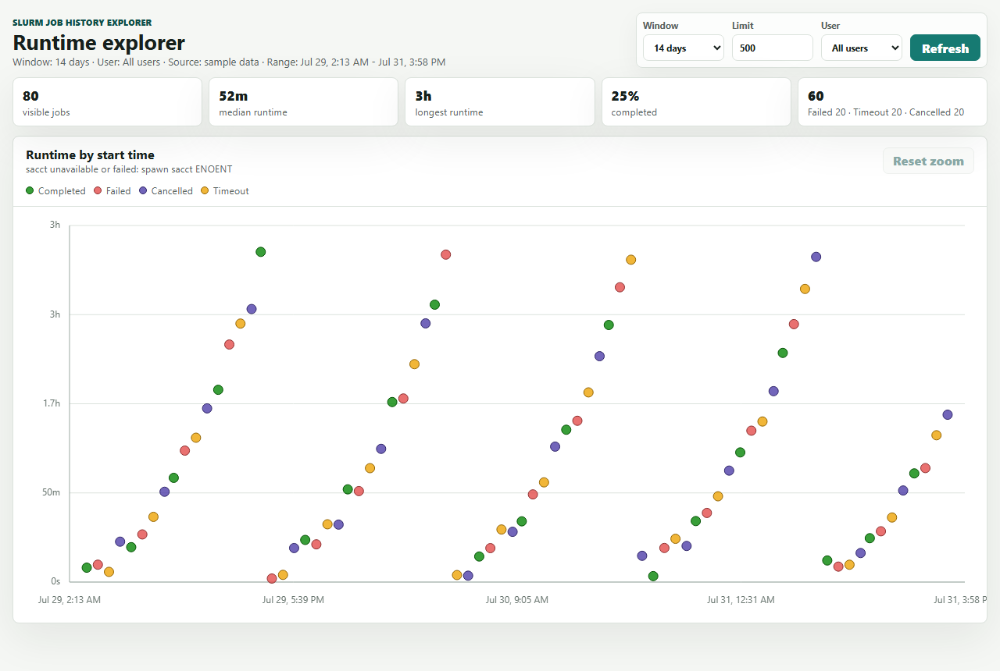
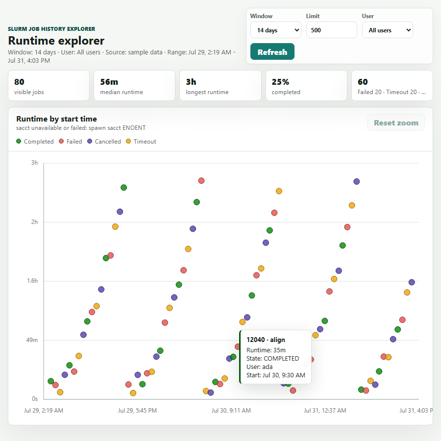

# Slurm Job History Explorer


A small Node.js web app for exploring Slurm `sacct` history in a browser. The first view is a runtime scatter plot that helps spot long-running jobs, failures, timeouts, and user-specific patterns.

## Features

- Pulls job allocation data from `sacct`
- Graphs job runtime by start time, on a linear or log-scale runtime axis
- Color-codes points by Slurm state (including out-of-memory and node-fail), using a categorical palette validated for color-vision-deficiency separation
- Filters by time window, row limit, and user
- Mousewheel or pinch-to-zoom scales the chart time range
- Hover tooltips show job details
- Accessible data table alternative to the chart, for keyboard and screen-reader users
- Demo mode (`npm run demo`) with generated sample data, for trying the UI without Slurm. In normal mode a failed `sacct` call shows an error instead of fake data

## Screenshots

These screenshots use sanitized sample data and do not show real cluster hosts, IP addresses, users, or jobs.





## Requirements

- Node.js 18 or newer
- Slurm accounting configured on the host
- `sacct` available in the service user's `PATH`, and that user has Slurm accounting read access (not just `sacct` on `PATH` — see [Troubleshooting](docs/troubleshooting.md#sacct-succeeds-but-returns-no-jobs) if `sacct` exits cleanly but every query returns zero jobs)
- No built-in authentication — see [Deployment](docs/deployment.md#access-control) for how to restrict access

No npm package install is required for the current app. It uses only Node built-ins and browser-native canvas.

## Quick Start

```bash
git clone https://github.com/dnightin/Slurm-Job-Explorer.git
cd Slurm-Job-Explorer
npm start
```

By default the app listens on all interfaces:

```text
http://0.0.0.0:3017
```

To try the UI on a machine without Slurm, start it in demo mode instead. It always serves generated sample data and says so in a banner:

```bash
npm run demo
```

Browse to the server by hostname or IP address:

```text
http://your-head-node.example.edu:3017
http://your-head-node-ip:3017
```

## Configuration

Environment variables:

| Variable | Default | Description |
| --- | --- | --- |
| `PORT` | `3017` | TCP port for the web server |
| `HOST` | `0.0.0.0` | Bind address. Use `127.0.0.1` for local-only access |
| `DEMO_MODE` | unset | Set to `1` to serve sample data instead of calling `sacct` (same as `--demo`) |
| `SACCT_TIMEOUT_MS` | `60000` | How long to wait for `sacct` before returning an error |
| `SACCT_MAX_BUFFER_MB` | `64` | Largest `sacct` output accepted, in MB. Raise it for long windows on busy clusters |

Example:

```bash
PORT=8080 HOST=0.0.0.0 npm start
```

## How It Works

The server exposes `/api/jobs`, runs `sacct`, parses pipe-delimited output, filters jobs to the requested time window, keeps the newest jobs up to the row limit, and returns JSON to the browser. The frontend renders the scatter plot with canvas.

The `sacct` query requests allocation rows using:

```text
JobIDRaw, JobName, User, Account, Partition, State, Submit, Start, End, Elapsed, AllocCPUS, TotalCPU, MaxRSS
```

## Documentation

- [Deployment](docs/deployment.md)
- [Usage](docs/usage.md)
- [API](docs/api.md)
- [Troubleshooting](docs/troubleshooting.md)

## Development

Start the app:

```bash
npm start
```

Syntax-check the JavaScript:

```bash
node --check server.js
node --check public/app.js
```

Run the unit tests (Node's built-in test runner, no extra dependencies):

```bash
npm test
```

GitHub Actions runs `node --check` and `npm test` on Node 18.x and 20.x for every push and pull request — see [`.github/workflows/ci.yml`](.github/workflows/ci.yml).
